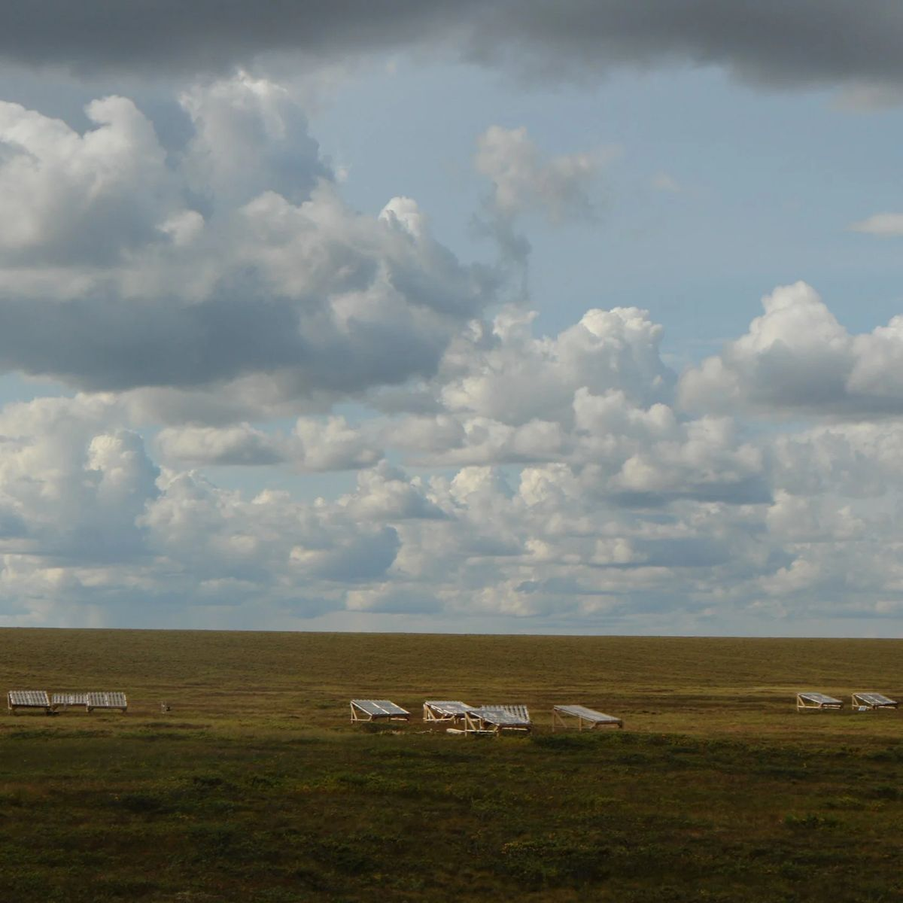
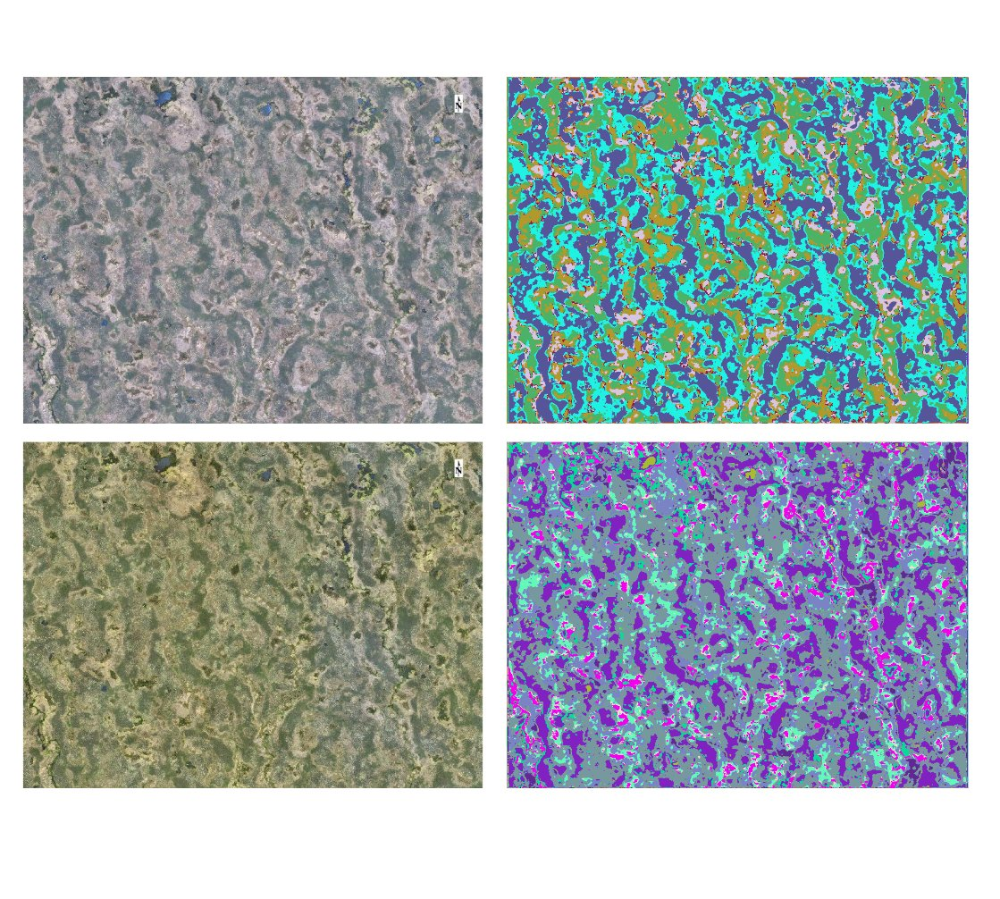
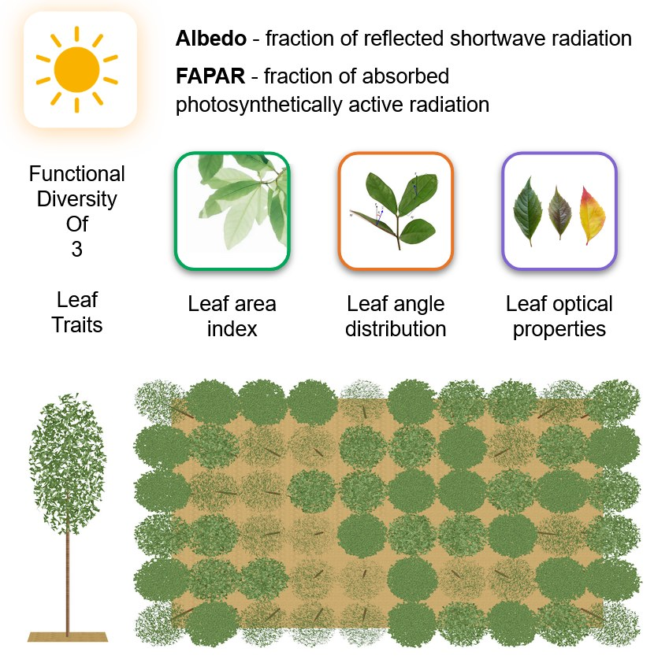
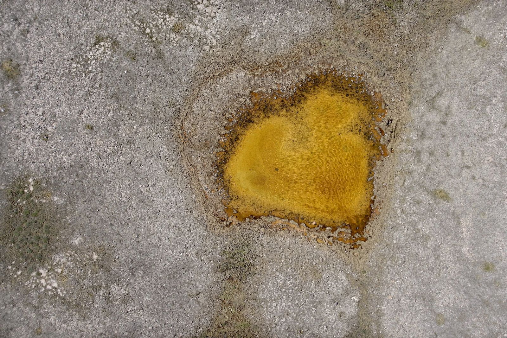

::: {style="max-width: 1140px; margin: 0 auto 3rem;"}

::: {.scale-strip}
[From plot to planet]{.scale-title}

```{=html}
<div class="scale-axis" aria-hidden="true"></div>
<ol class="scale">
  <li><span class="scale-name">Plot</span>
      <span class="scale-keys">Vegetation surveys · Plant traits · Phytomass · eDNA · Plot-level experiments</span></li>
  <li><span class="scale-name">Landscape</span>
      <span class="scale-keys">Drone imagery · Meteo stations · Flux towers · Land cover maps · Topography</span></li>
  <li><span class="scale-name">Pan-Arctic</span>
      <span class="scale-keys">Landsat &amp; MODIS time series · Nighttime lights · Vegetation archives · Climate</span></li>
  <li><span class="scale-name">Earth system</span>
      <span class="scale-keys">Climate &amp; land surface models · Energy budget · Geoengineering scenarios</span></li>
</ol>
```
:::

::: {.method-row}

::: {.method-row-img}
{group="methods"}
:::

::: {.method-row-text}
## Experiment

- Tundra Rainfall Experiment (TRainEx)
- *In silico* experiments
    - Biodiversity experiment using radiative transfer modelling
    - Geoengineering experiments using climate models
:::

:::

::: {.method-row .reverse}

::: {.method-row-img .figure-fit}
{group="methods"}
:::

::: {.method-row-text}
## Observation

- Biodiversity and community composition assessments
- Plant trait measurements
- Phytomass sampling
- Soil and atmospheric *in situ* measurements
- eDNA soil sampling
- Drone imagery analysis (thermal, multispectral, DEM)
- Satellite imagery analysis
    - Time series from Landsat and MODIS
    - High-resolution imagery
    - Nighttime lights to map industrial activity
- Surveys with Indigenous communities
:::

:::

::: {.method-row}

::: {.method-row-img .figure-fit}
{group="methods"}
:::

::: {.method-row-text}
## Modelling

- Statistical analyses
    - Trend and correlation analysis
    - Image classification
- Process-based models (climate, land surface and radiative transfer models)
    - Analyses of climate reanalysis and model data (power spectrum analysis, geoengineering)
- Species distributions
:::

:::

::: {.method-row .reverse #data}

::: {.method-row-img}
{group="methods"}
:::

::: {.method-row-text}
## Data

- We collect data in the field, including vegetation surveys, soil eDNA,
  weather data, CO₂ measurements, soil moisture and temperature, and drone
  observations, and we compile data from literature reviews.
- We combine very different data sources, from vegetation plots to
  drone and satellite images and climate model output.
- We share our data as openly as possible, following the
  FAIR principles (Findable, Accessible, Interoperable, Reusable)
  [[]{.bi .bi-link-45deg}](https://www.gofair.foundation/fair-principles){.link-sign title="FAIR principles"}.
  One example is the Russian Arctic Vegetation Archive, a database of
  plant community composition and environmental conditions
  [[]{.bi .bi-link-45deg}](https://doi.org/10.1111/geb.13724){.link-sign title="Zemlianskii et al. 2023, Global Ecology and Biogeography"}.
:::

:::

:::
